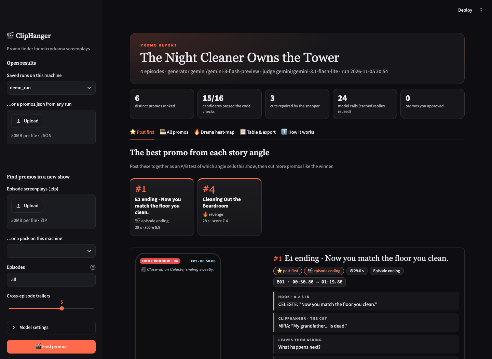
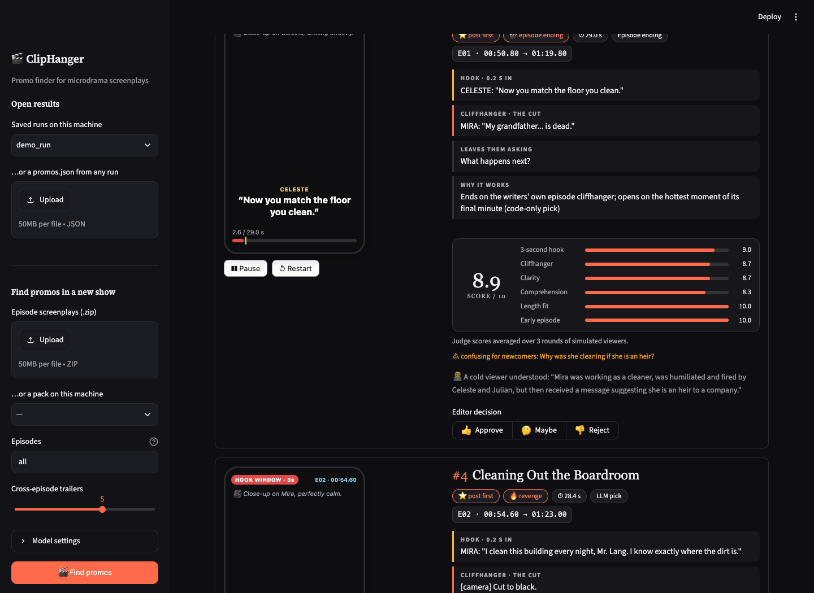

# ClipHanger 🎬

**Finds promo clips in microdrama screenplays.** Give it a show's episode scripts; it returns ranked
20–60 s promos. Each promo opens on a hook within 3 seconds, ends on a cliffhanger, and makes sense to
someone who has never seen the show. For each one you get the exact segment timestamps (in play
order), the hook, the cliffhanger, why it works, and a **Script Player** that plays it as a timed
read-along before anyone opens an editing timeline.



## The review app

`streamlit run app.py` opens a dark "screening room" for promo editors:

- **⭐ Post first:** the best promo of each story angle, shown as poster cards. Post them together as an
  A/B test of which angle sells the show.
- **Promo cards:** a phone-shaped **Script Player** plays the promo as a timed read-along (3-second hook
  mark, cut marks, a ✂ CUT card on the cliffhanger). Next to it are the segments, hook, cliffhanger,
  why it works, the judges' scores and the cold viewer's read, with 👍 / 🤔 / 👎 editor decisions.
- **🎞️ All promos:** filter by story angle, source (LLM picks, cross-episode trailers, episode endings)
  and minimum score.
- **🔥 Drama heat-map:** code-only drama intensity across every episode, with the top promos outlined.
- **📋 Table & export:** a sortable table and `promos.csv` / `promos.json` downloads that include your decisions.
- Open a saved run directly with `?run=<folder in outputs/>`, or load any `promos.json`.



## Try it on the demo show

`samples/demo_show.zip` is **"The Night Cleaner Owns the Tower"**: an original 4-episode microdrama
written to test ClipHanger. It contains no real show content and uses the same screenplay format.

```bash
.venv/bin/python -m cliphanger run --input samples/demo_show.zip   # ~3 min on Gemini's free tier
```

You can also upload the zip in the app. The screenshots above are from this demo.

## How it works

```
screenplays.zip
  ├─[1] PARSE     code   every block (shot, action, sound, line) → ID like E01-B034 + start/end
  ├─[2] MINE      LLM    per batch of episodes: hooks, cliffhangers, 2–3 promo ideas each,
  │                      citing moments by block ID only (the LLM never writes a timestamp)
  ├─[3] VALIDATE  code   IDs → times · cuts snapped onto shot changes, never mid-line ·
  │                      hook ≤ 3 s (else trim, or open with a flash-forward) · end on the
  │                      cliffhanger · 20–60 s · every change recorded
  ├─[4] STITCH    LLM    cross-episode trailers from the strongest beats; rejected ones go
  │                      back to the model once with the exact reasons
  ├─[5] JUDGE     LLM    a different model plays three viewers: a 3-second scroll test (sees
  │                      only the first 3 s), a cold viewer (no title, no context), and a
  │                      comprehension check against the true logline
  └─[6] RANK      code   weighted score (weights in config.yaml) · near-duplicates folded ·
                         "post first" slate = best promo per story angle
```

| Code (deterministic) | LLM (judgement) | Human editor |
|---|---|---|
| parsing, IDs, all timestamp maths, cut snapping, length/hook/cliffhanger rules, ranking, outputs, caching | spotting hooks and cliffhangers, judging "makes sense on its own", one-line "why it works" | plays promos in the Script Player, approves/rejects in the app, exports the decisions |

## Quick start

```bash
python3 -m venv .venv && .venv/bin/pip install -r requirements.txt
cp .env.example .env            # paste a free key from https://aistudio.google.com/apikey

# whole pipeline → outputs/run_<time>/ (report.html, report.md, promos.csv, promos.json, raw replies)
.venv/bin/python -m cliphanger run --input "path/to/show-scripts.zip"

# the review app (upload a zip, play promos, approve/reject, export)
.venv/bin/streamlit run app.py               # then open http://localhost:8501/?run=<a run folder>

```

A first run on 50 episodes needs ~114 requests: 12 to the generator model (10 mining batches, stitch
+ one revision) and ~100 small judge requests (3 rounds). That's ~676K tokens in / 122K out, and
~20 minutes on Gemini's free tier, where a client-side limiter keeps it under the per-minute caps.
Every reply is cached, so re-runs are instant and free, and an interrupted run resumes where it
stopped.

## Commands

| Command | What it does |
|---|---|
| `run --input X [--model M] [--judge-model J] [--episodes 1-10] [--stitch 5]` | the full pipeline |
| `parse --input X` | parse only; writes readable transcripts and the exact text the LLM sees |
| `models --provider gemini --match flash --probe` | which models your key can actually use right now |
| `mine --input X --episodes 1,13,42` | mining + validation only, printed for inspection |
| `validate --input X --ideas run/ideas.json` | re-run the validator on saved ideas (no API cost) |
| `eval --input X --run outputs/run_…` | no-AI baseline judged by the same judges, a human grading sheet, run-vs-run overlap |
| `report --run outputs/run_…` | rebuild report.html for a saved run |

## Swap the model (one line)

Models are `provider/model` strings, set in `config.yaml` or per run with `--model` / `--judge-model`:

```bash
--model gemini/gemini-3.6-flash               # default (free tier)
--model anthropic/claude-sonnet-5-5           # needs ANTHROPIC_API_KEY
--model groq/llama-3.3-70b-versatile          # any OpenAI-compatible provider: groq, openrouter, openai, ollama
--model custom/<model>                        # your own gateway: set CLIPHANGER_BASE_URL + CLIPHANGER_API_KEY
```

Each role has a fallback chain in `config.yaml`. Overloaded or quota-exhausted models are skipped
automatically, and every output records which model produced it.

## Outputs (per run)

`report.html` (open in any browser: every promo with its Script Player) · `report.md` · `promos.csv`
(one row per promo, for a spreadsheet) · `promos.json` (everything, incl. sub-scores and the timed
script) · `candidates_all.json` (incl. rejected ideas and why) · `raw_llm_replies/` · `run.json`
(models, tokens, time, config).

## Known limits

- It reads the script, not the video: a scripted slap may not land on screen.
- Clarity is judged from text that includes character names, which a real viewer doesn't see.
- Cross-episode trailers are the weakest output: names and context don't carry across episodes.
- AI-written scripts drift on names (this pack spells one title four ways); promos that show two
  spellings are flagged, not fixed.

## Tests

```bash
.venv/bin/python -m pytest -q    # synthetic fixtures; the real-pack test runs only if the pack is present
```

## Who did what

| Hansika Gupta (human) | AI |
|---|---|
| **Chose the problem and the process:** picked Problem 1 and had it built plan-first, then step by step with a review checkpoint after each stage | **Claude Code (Claude Opus 5.5)** proposed the plan and design, wrote the code, prompts and tests, ran the experiments and evaluation, and drafted the solution doc and this README |
| **Set the quality bar** (a creative, shortlist-worthy solution, not a minimal one) and **made the delivery decisions**: GitHub account, submission format, what the doc must and must not include | **Gemini models** do the judgement inside the pipeline: finding promos and judging them as simulated viewers |
| **Steered revisions** to the solution doc's readability and layout, the app's UI and this repo; set up the API key and published the code | Every number in the docs comes from logged runs, so each claim can be checked against the raw outputs |

## Models used

| Where | Model | Role |
|---|---|---|
| Development | Claude Opus 5.5 (Claude Code), with web search | planning, code, tests, analysis, docs; checked Gemini's free-tier limits and prices |
| Pipeline: generator | Gemini 3.6 Flash (default), Gemini 3 Flash Preview (final run), Gemini 3.8 Flash (fallback) | mines promo ideas per episode, stitches cross-episode trailers |
| Pipeline: judge | Gemini 3.1 Flash-Lite (default), Gemini 3.5 Flash-Lite (fallback) | 3-second scroll test, cold-viewer test, comprehension check |
| Probed, not used | Gemma 4 31B, Gemini 4 Argon, Gemini Pro | tested for free-tier availability (slow, or no free quota) |

## Confidentiality

Show scripts are confidential. This repo holds code and synthetic test fixtures only; input packs,
transcripts, outputs and caches are git-ignored.
